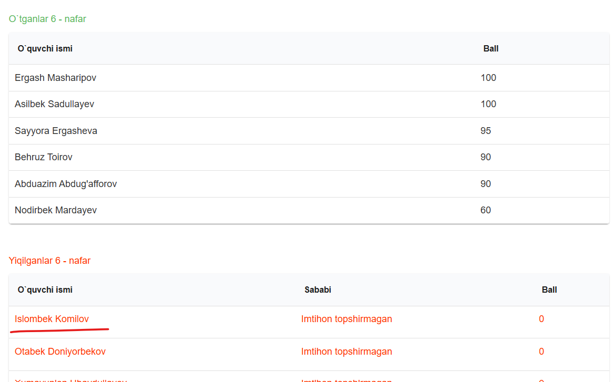

# LOOK ORDER

A lightweight full-stack app for managing customers and their food orders. The frontend is built with HTML, CSS, and browser JavaScript; the REST API is built with Node.js and Express and stores its data in JSON files.

## Features

- View customers and their contact numbers.
- Add a customer.
- Select a customer to view their orders.
- Browse available foods and add them to a customer's orders.
- Keep customer and order data in browser local storage.

## Getting started

### Branch note

For this project, `real-api/connection` is the main working branch for local full-stack development: it connects the frontend to the Express server in this repository. The Git `main` branch uses a remote API instead. The setup steps below describe `real-api/connection`.

### Requirements

- A modern web browser.
- Node.js and npm.
- A local static-file server for the frontend (Python 3 or an editor extension such as Live Server).

### Start the API

In a terminal, install the backend dependencies and start the Express server:

```powershell
cd LOOK_PROJEC_SERVER
npm ci
npm run dev
```

The API listens on `http://localhost:5000` by default. The backend reads `SECRET_KEY` from `LOOK_PROJEC_SERVER/.env` to sign user tokens; create that local file and set a private value there. You can also set `PORT` to use a different port. Do not commit the `.env` file; it is ignored by Git.

### Run the frontend

In a second terminal opened at the project root, start a static-file server:

```powershell
py -m http.server 5500
```

If `py` is unavailable, use `python -m http.server 5500`. This Python command serves only the static frontend; the API itself runs on Node.js and Express. Then open [http://localhost:5500](http://localhost:5500) in your browser.

Alternatively, serve the frontend with an editor extension such as Live Server. Serving the files over HTTP (rather than opening `index.html` directly) is recommended.

### Configure the API

The frontend API base URL is defined in [`js/api.js`](./js/api.js):

```js
const API = `http://localhost:5000/api/v1`;
```

Change it to the URL of your API if it runs elsewhere. The Express server currently allows cross-origin requests.

## API expectations

The frontend uses these endpoints:

| Method | Endpoint | Purpose |
| --- | --- | --- |
| `GET` | `/users` | Retrieve customers |
| `POST` | `/users` | Create a customer with `username` and `telephone` |
| `GET` | `/foods` | Retrieve available foods |
| `GET` | `/orders/:id` | Retrieve orders for a customer |
| `POST` | `/orders` | Create an order with `foodId`, `userId`, and `count` |

Successful responses include `status` and `data` properties. The frontend checks for status `200` on reads and `201` on creates. Food records include `foodId`, `food_name`, and `food_img`; order records include `count` and a `foods` array containing food details. If a customer has no orders, the API responds with status `404` and an empty `data` array.

The API reads and writes its data in `LOOK_PROJEC_SERVER/src/db/*.json`. Changes made by creating customers or orders are persisted in these files.

## Project structure

```text
.
├── index.html          # Application page
├── css/
│   └── main.css        # Styles
├── img/                # Logo and food images
├── js/
│   ├── api.js          # API base URL
│   ├── class.orders.js # Order and menu behavior
│   └── ik-look.js      # Customer behavior
└── LOOK_PROJEC_SERVER/
    ├── src/
    │   ├── controllers/ # API request handlers
    │   ├── db/          # JSON data files
    │   ├── routes/      # Express API routes
    │   ├── utils/       # JSON file storage helper
    │   └── server.js    # Express application entry point
    ├── package.json
    └── package-lock.json
```

Axios is loaded from a CDN in `index.html`; an internet connection is needed for that dependency and the remotely hosted fonts and icons.

## Browser storage

Customer and order data are cached in `localStorage` under the `users` and `orders` keys. The selected customer is stored under `clickedUser`. Clearing this site's browser storage removes these cached values.

## A personal note

The repository's About message was:

> hands down that you've got the highest score in this month as well.

After the exam, I wanted to add this update:

> Actually I couldn't pass it, failfailure faced me :( -- 12.10.2026.

The screenshot below shows the exam results that inspired this update.


